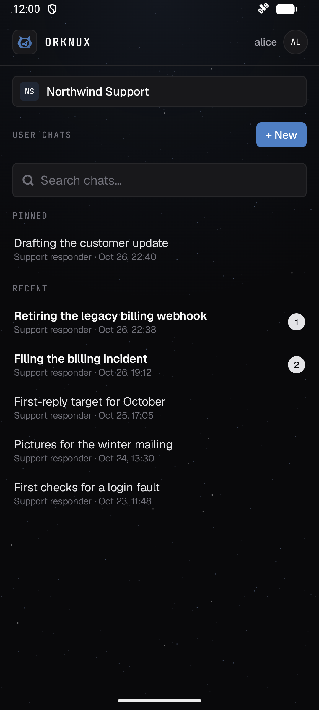
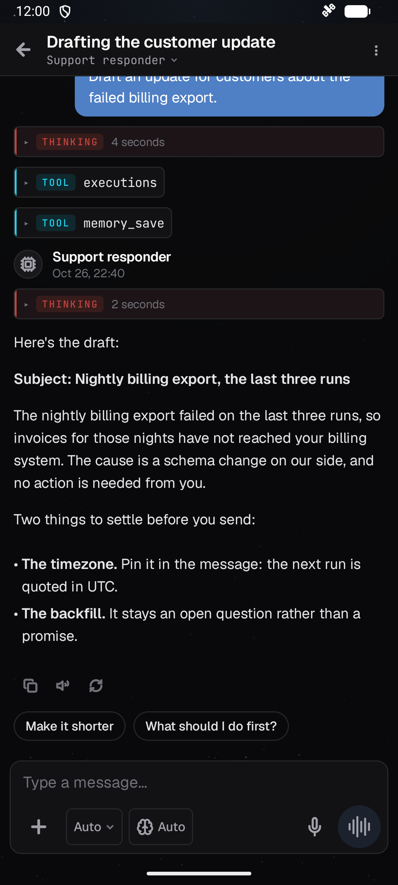
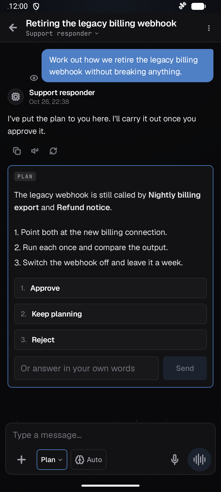
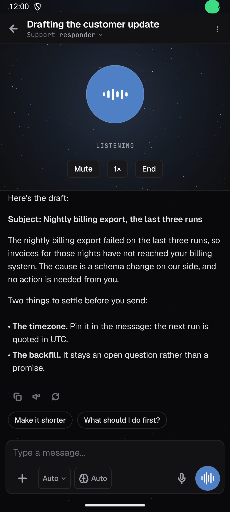

# Orknux Mobile

The Android client for [orknux-server](https://github.com/orknux/orknux-server). Chat and voice for now; the other
perspectives (Flow, Design, Explore, Workspace) will join it.

<p>
  
  
  
  
</p>

## Running it

Open this folder in Android Studio and run `app`, or:

```
./gradlew :app:installDebug
```

Then enter your server's address. A server on your own computer listening only on `127.0.0.1` is reached from
an emulator or a USB phone by tunnelling, with `localhost:8080` as the address:

```
adb reverse tcp:8080 tcp:8080
```

## Checks

```
./gradlew :app:testDebugUnitTest          # the protocol and voice rules, no device needed
./gradlew :app:connectedDebugAndroidTest  # the whole voice loop against a real server
```

The second needs a running device, `adb reverse` as above, and a server with no sign-in whose workspace has
transcription and speech models. It is skipped where there is none. It replaces only the microphone with a
recording, makes one chat and deletes it, and uninstalls the app when it ends, which signs the app out.

`scripts/emu.sh` drives a running emulator (screenshots, taps, what is on screen).

CI (`.github/workflows/ci.yml`) runs the unit tests and builds on every push and pull request. A `v*` tag also
builds the signed APK and publishes the GitHub release. It needs the `ORKNUX_ANDROID_KEYSTORE` (base64),
`ORKNUX_ANDROID_KEYSTORE_PASSWORD`, `ORKNUX_ANDROID_KEY_ALIAS` and `ORKNUX_ANDROID_KEY_PASSWORD` secrets. Releasing is
described in `.claude/skills/cut-release/SKILL.md`; `scripts/screenshots.sh` retakes the pictures in `docs/screens`
against a made-up server, on an emulator only.

## How it is put together

| Package | What it holds |
| --- | --- |
| `core` | The server connection, event streams, sign-in and stored credentials |
| `design` | The web client's tokens, the sky, icons and shared controls |
| `shell` | The perspective registry and navigation |
| `signin` | Connecting and signing in |
| `chat` | The chat perspective |
| `voice` | Turn detection, reading aloud and the voice panel |

**Adding a perspective:** write its screens, describe it as a `Perspective` (see `chat/ChatPerspective.kt`) and
list it in `Perspectives` in `shell/Shell.kt`. The bottom bar appears once there are two.

**The look comes from the web client.** `design/Theme.kt` copies `orknux-ui/src/styles/tokens.css` with the blue
accent, and `OrkIcons.kt` is generated from its SVGs by `scripts/generate_icons.py`. Change them there first.

**The rules come from the server's behaviour**, and where they are not obvious they match the web client's:
`chat/TurnReader.kt` follows `api/chat.ts`, and `voice/` follows `VoiceMode.tsx`, so a workspace's voice settings
mean the same thing on a phone.

## Decisions worth knowing

- **Android only for now.** The networking, chat and voice rules are plain Kotlin, which keeps a later iOS
  target open, but nothing here is built or tested for it.
- **Pictures from outside the server become links.** A model's answer can't make the phone fetch an outside
  address. In a browser an installation can close that road with its content-security policy; nothing enforces
  that policy here, so it stays closed.
- **Voice ends when the app leaves the screen.** Keeping the microphone open unseen needs a foreground service,
  which has not been built. The turn itself goes on and lands in the history.
- **OIDC and GitHub installations sign in with an access token**, because a browser redirect ends in a cookie this
  app can't receive. The server only issues tokens to internal users, so other accounts on those installations
  can't sign in from a phone yet.
- **Cleartext http is allowed** because self-hosted servers on a LAN or VPN often have no certificate. The
  sign-in screen warns when a password would cross a network unencrypted.
